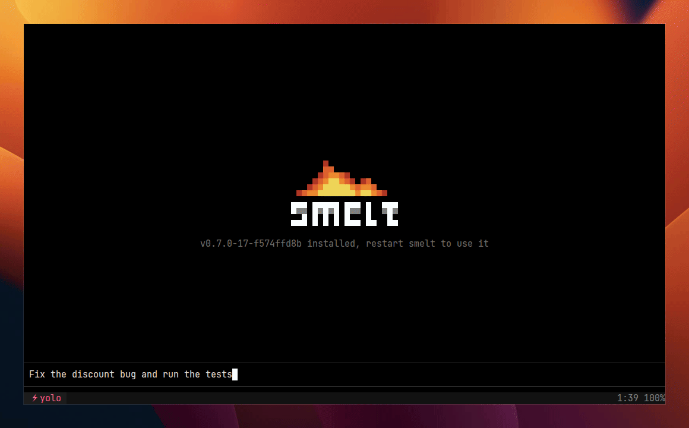

# agent-mux

Browse AI coding agents in tmux, preview their output, and jump between
sessions. Supports Smelt, Claude Code, Open Code, Gemini CLI, Codex CLI, and
Kimi CLI.

<p align="center">
  
</p>

## Install

Requires Rust 1.88+ and tmux. From this checkout:

```sh
cargo install --path .
```

Use the same command to upgrade. Open TUIs pick up validated updates
automatically; otherwise, updates take effect on the next launch.

## Use

Run inside tmux:

```sh
agent-mux
```

Use Up/Down to preview a session. Click or press Enter to open it. Background
monitoring starts and recovers automatically. Watcher errors appear alongside
the session list; agent sessions and saved UI state are preserved.

Optional shortcut in `~/.tmux.conf`:

```tmux
bind j new-window agent-mux
```

Reload with `tmux source-file ~/.tmux.conf`, then use `prefix + j`.

### Keys

| Key                       | Action                             |
| ------------------------- | ---------------------------------- |
| `j` / `k` or Up/Down       | Move down/up                       |
| `h` / Left                | Collapse current section           |
| `gg` / `G`                | First/last session                 |
| `Enter`                   | Open session                       |
| `s` / `u`                 | Stash/unstash                      |
| `a`                       | Add window in selected project     |
| `space` / `A`             | Toggle read/unread / mark all read |
| `dd`                      | Kill session                       |
| `o`                       | Toggle recent/creation order       |
| `H` / `L` or drag divider | Resize sidebar                     |
| `?`                       | Full key help                      |
| `q` / `Esc`               | Quit                               |

New windows use the project's main checkout and append to the selected agent's tmux session.

### Sidebar

Sessions are grouped by project, with the latest state changes first.

- **Working**: busy agents, returned to the main list when finished.
- **Stashed**: sessions set aside with `s`, including busy ones.

Sections expand when entered and collapse when left. Click a section title to
expand and select its first session, or collapse it. A section stays open if
there is no other session to select, or it is configured to stay expanded.
Startup selects an unread, non-stashed session, then falls back to your last
selection or the first session. Finished, unfocused sessions become unread;
opening them marks them read.

## Configuration

Optional file: `~/.config/agent-mux/config.toml` (or
`$XDG_CONFIG_HOME/agent-mux/config.toml` if set).

Defaults:

```toml
new_window_command = "" # shell | smelt | opencode | codex | claude

[sidebar]
sort = "recent"      # recent | creation; unset: saved choice
select = "unread"    # unread | last | first
working = "collapse" # collapse | expand | inline
stashed = "collapse" # collapse | expand
```

Set `working = "inline"` to keep busy sessions in the normal list, without a
Working section. Stashed sessions remain separate. Reopen agent-mux to apply
changes.

## Development

```sh
cargo run --release
cargo test
cargo clippy --all-targets -- -D warnings
```

Build with `cargo build --release` before running the [E2E tests](tests/).
